# Photon and bit allocation for routed snapshot spectral sensing

A decoder- and calibration-aware computational study on 15 CAVE scenes

Project: Vansh Jain | AI-assisted research draft | 13 October 2026

## Abstract

We study how a fixed digital output budget should be divided between spectral-channel count and per-channel ADC depth under photon-limited acquisition. A 31-band CAVE subset is simulated through routed and equal-area absorptive optical models, Poisson detection and finite-bit quantization. The primary budget is 24 bits per spatial macro-pixel. Fifteen outer scene folds separate training, validation and testing. A robustness sweep evaluates four decoders and twelve configurations, producing 72,090 trial-condition-decoder records. Allocation preferences depend materially on reconstruction and quantization; the initial clean-trained-decoder transition is not a universal sensor rule. After validation-only allocation selection, the modeled router changes mean RMSE relative to the filter by 24.6% at exposure N=100 and 1.7% at N=100,000 (positive means lower router error). We release simulation outputs, code, plots and a compact validation-fitted risk rule. Conclusions are limited to the specified model and dataset subset, not a fabricated camera or a universal optimum.

## Research question

With a fixed area, exposure and output-bit budget, should a sensor record a few spectral channels precisely or more channels coarsely? Does preserving photons through routing change that decision, and does the answer survive changes in the reconstruction method?

## Contribution and scope

The contribution is a controlled joint-budget comparison and a tested design-selection procedure. The ingredients are established. No optical device was fabricated; no world-first priority or competition outcome is claimed. All noise realizations are numerical simulations applied to real measured spectra.

The main body presents version 2. Earlier pilot figures are retained separately because the decoder, split and metric conventions were revised. Full equations, configuration details and assumptions are in METHODS.md.

---

## 1. What is being designed?

Figure 1. Forward model. The router and filter are alternative optical paths. Photon counts, not semantic colors, enter the ADC and decoder.

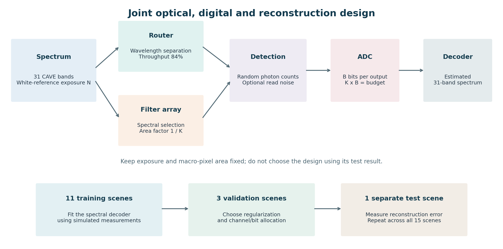

A spatial macro-pixel contains K detector outputs. The sensor emits B bits from each output, so K times B is fixed. At 24 bits, the candidates are 3x8, 4x6, 6x4, 8x3, 12x2 and 24x1. The 3x8 candidate is a three-band spectral sensor, not a complete commercial RGB-camera model.

The optical design is chosen before acquisition. The ADC converts the resulting counts into digital codes; the decoder subsequently estimates the original 31-band spectrum. A post-capture algorithm cannot recover information that was never measured without relying on a learned prior.

Routing preserves more of the available light by directing wavelengths to different outputs. Absorptive filters discard out-of-band light. Under the equal-area macro-pixel model, each filter occupies 1/K of the area, creating the extra area factor below. Spatial sampling is otherwise idealized.

| Quantity | Router | Filter |
| --- | --- | --- |
| Mean channel count | N eta (P x)k | N tau (P x)k / K |
| Flat-white approximation | N eta / K | N tau / K<super>2</super> |
| Baseline throughput | eta = 0.84 | tau = 1.0 |

N denotes white-reference photon exposure. Actual scene pixels vary in brightness; they do not each receive the same detected photon count. Unit quantum efficiency and equal photon weighting of the 31 input bands are assumed.

---

## 2. Validation and measurement protocol

| Item | Protocol |
| --- | --- |
| Data | 15 supplied CAVE scenes; 31 normalized bands, 400-700 nm |
| Outer folds | Each scene is tested once |
| Per fold | 11 training scenes; next 3 cyclic scenes validate; 1 test scene |
| Pixel counts | 6,600 training; 3,072 validation; 4,096 test |
| Noise realizations | Two corrupted training copies; one validation draw; three test trials |
| Exposure grid | 10 to 100,000 white-reference photons at nine sampled levels |
| Primary outcome | Mean scene spectral RMSE; SAM and PSNR secondary |
| Uncertainty | 10,000 paired scene-bootstrap resamples, descriptive |

The matched affine decoder learns from the same Poisson-plus-ADC process used at evaluation. Ridge strength is chosen from four values on validation scenes, separately for each allocation and exposure. The allocation selector then chooses the smallest validation error. No test scene is used for either choice.

The controls are a clean-trained affine decoder, a modest quadratic ridge model and nonlearned interpolation. All outputs are clipped to the valid reflectance range. These controls test reconstruction dependence; they do not exhaust possible algorithms.

The ADC uses a white-reference full scale with headroom 1.2. Full scale is recalibrated for each exposure, optical mode and channel count, not for the test scene. The experiment therefore assumes exposure-dependent gain, rather than a single fixed full-well range.

SAM excludes zero reference vectors. A nonzero reference reconstructed as zero receives 90 degrees, rather than disappearing from the average. Very dark spectra remain in the metric. PSNR is averaged after per-scene calculation and is not simply computed from the aggregate RMSE.

The source archive is a subset, and outer folds reuse training scenes. Bootstrap intervals describe variation in this set, not a guaranteed population-level confidence statement. The robustness analysis followed inspection of the pilot and is explicitly exploratory.

---

## 3. Allocation curves with a matched decoder

Figure 2. Held-out scene-mean RMSE for each 24-bit candidate. Curves are conditional on the stated decoder and uniform ADC.

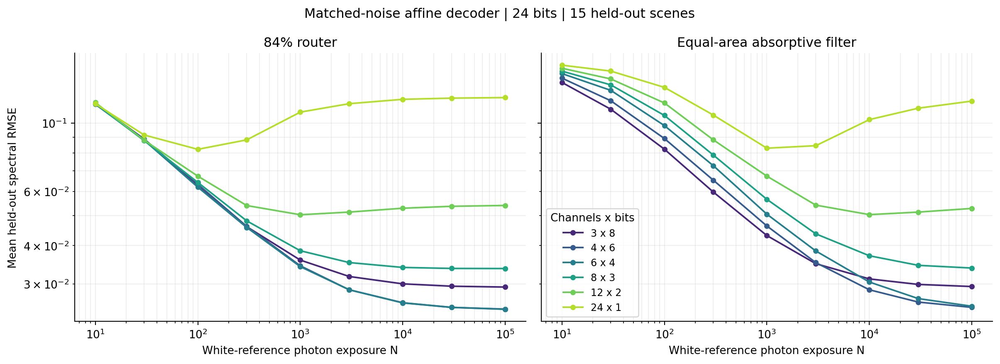

| Exposure N | Router winner | Filter winner | Router RMSE | Filter RMSE |
| --- | --- | --- | --- | --- |
| 10 | 6 x 4 | 3 x 8 | 0.1150 | 0.1354 |
| 30 | 8 x 3 | 3 x 8 | 0.0876 | 0.1108 |
| 100 | 6 x 4 | 3 x 8 | 0.0619 | 0.0822 |
| 300 | 6 x 4 | 3 x 8 | 0.0458 | 0.0597 |
| 1,000 | 6 x 4 | 3 x 8 | 0.0342 | 0.0431 |
| 3,000 | 4 x 6 | 3 x 8 | 0.0288 | 0.0350 |
| 10,000 | 6 x 4 | 4 x 6 | 0.0261 | 0.0288 |
| 30,000 | 6 x 4 | 4 x 6 | 0.0252 | 0.0262 |
| 100,000 | 6 x 4 | 4 x 6 | 0.0249 | 0.0252 |

These are descriptive minima over test-scene means, not the performance of a design selected without test information. Near-ties require paired comparisons: the numerical winner alone does not establish a meaningful advantage. The full dataset includes bootstrap winner support and paired 3-versus-4-channel contrasts.

---

## 4. The first result was decoder-dependent

Figure 3. Preferred allocations under four reconstruction methods with the same version-2 data split. Cells report lowest mean test RMSE.

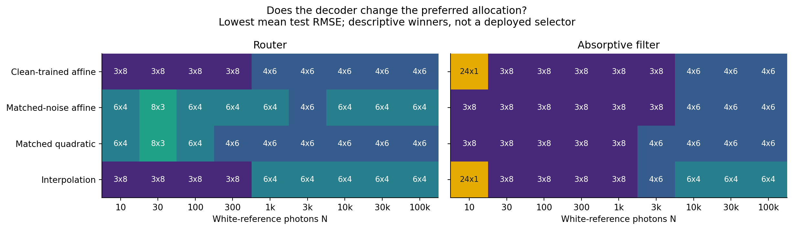

The initial pilot suggested a simple 3x8-to-4x6 transition as light increased. That statement used a decoder trained on noiseless measurements. Once training includes the actual noise and quantization, the allocation map changes. A clean-trained inverse can amplify weak-channel noise; a matched estimator can trade bias against that noise using the training prior.

This is a consequential finding: a channel/bit recommendation cannot be separated from the reconstruction procedure. It also prevents treating an apparent moderate-K optimum from one decoder as a general physical law. The legacy pilot is retained for traceability, not pooled with the revised results.

The quadratic control adds squared measurements and adjacent-channel products. It is a controlled nonlinear baseline, not an attention model or new neural architecture. Interpolation tests how much of the result depends on learned spectral correlations.

Neither more channels nor more bits is always best. More channels reduce spectral averaging but reduce photons per output and code depth. A better decoder changes the balance; it does not repeal photon statistics or restore arbitrary missing spectral detail.

---

## 5. Calibration and sensor sensitivity

Figure 4. One-factor sensitivity tests plus one combined stress condition. Entries are descriptive winners under the matched affine decoder.

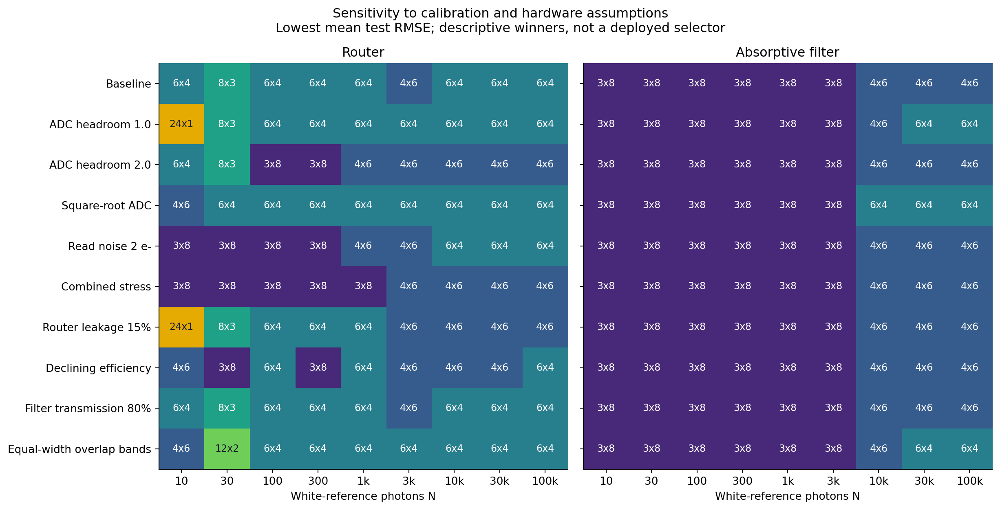

Changing ADC headroom or the code distribution changes how effectively low bit depths represent the signal. Read noise penalizes measurements with small counts. Router crosstalk mixes neighboring channels while conserving total photons; the matched decoder is calibrated to the known mixing.

The stress values are modeling choices, not properties measured from a fabricated device. The declining-throughput curve drops from 84% at three channels to 60% at 24 channels. It is intentionally hypothetical and must not be presented as the result of an electromagnetic design or a measured device family.

---

## 6. Does selection help on unseen scenes?

Figure 5. Allocation selected using validation scenes, then tested on a different scene. The null predictor outputs the training mean spectrum without seeing the measurements.

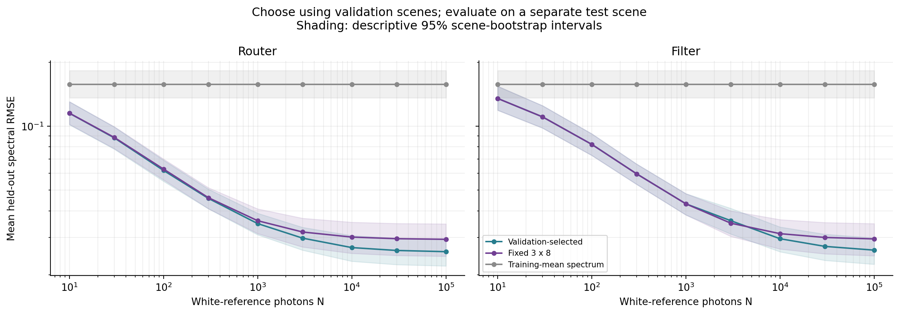

Figure 6. Paired RMSE differences against fixed 3x8. Intervals crossing zero do not resolve the sign of improvement within this bootstrap analysis.

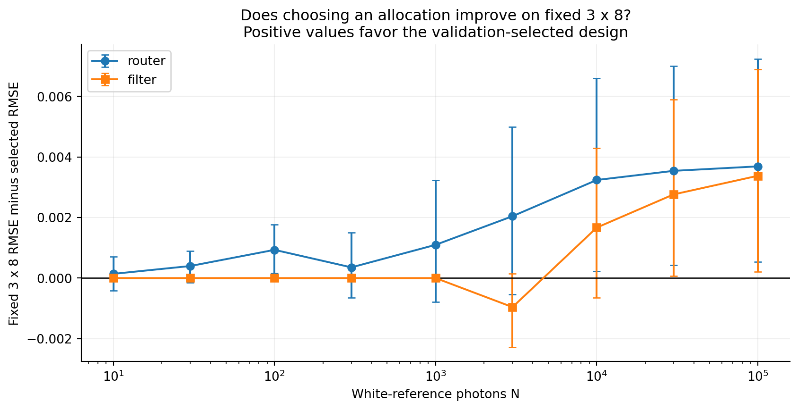

A test-oracle winner is an analysis aid, not a deployable algorithm. The validation selector is the actual procedure tested here. Its errors, including occasions when it chooses worse than fixed 3x8, remain in the results. Near-zero-light conditions are retained and compared with the null predictor, rather than removed to improve the narrative.

---

## 7. What does routing add?

Figure 7. Router improvement after each optical mode selects an allocation using validation scenes. Shading is a paired scene-bootstrap interval.

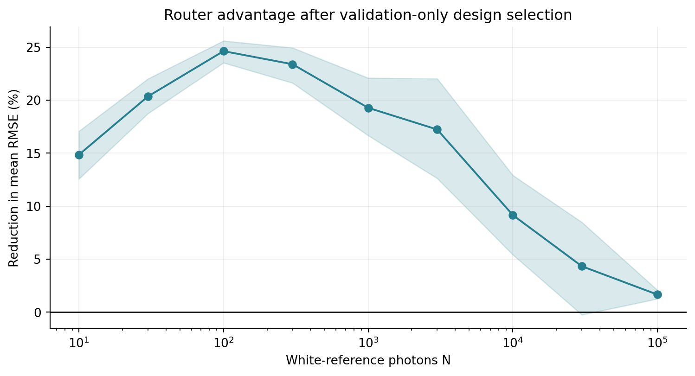

| N | Router RMSE change (%) | Bootstrap interval (%) |
| --- | --- | --- |
| 30 | 20.3 | 18.7 to 22.0 |
| 100 | 24.6 | 23.5 to 25.6 |
| 1,000 | 19.3 | 16.7 to 22.1 |
| 10,000 | 9.2 | 5.4 to 12.9 |
| 100,000 | 1.7 | 1.3 to 2.1 |

Positive change here means lower mean RMSE for the router. This is the benefit under the explicit throughput and equal-area model, not a comparison against measured commercial-camera output. At high exposure, spectral representation and quantization can dominate, reducing the benefit of recovering additional photons.

The earlier phrase "a tenfold earlier transition" described two sampled pilot-grid winners. It did not estimate an exact physical transition or establish its confidence interval. Because matched reconstruction changes the map, it is not the headline conclusion of this revised study.

---

## 8. Budget sensitivity and a compact rule

Figure 8. The optimum is conditional on total output budget as well as light and optical model.

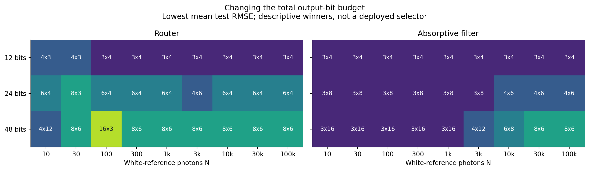

A practical designer can select a candidate by simulating or calibrating validation spectra at the intended exposure and choosing the lowest expected error. To reduce the calibration sweep, we additionally fit the approximate risk CK + AK/N at only three validation exposures: 30, 1,000 and 30,000.

Figure 9. Test error from the three-anchor risk surrogate versus the full validation sweep and fixed 3x8. The surrogate is an approximation, not a proven optimum.

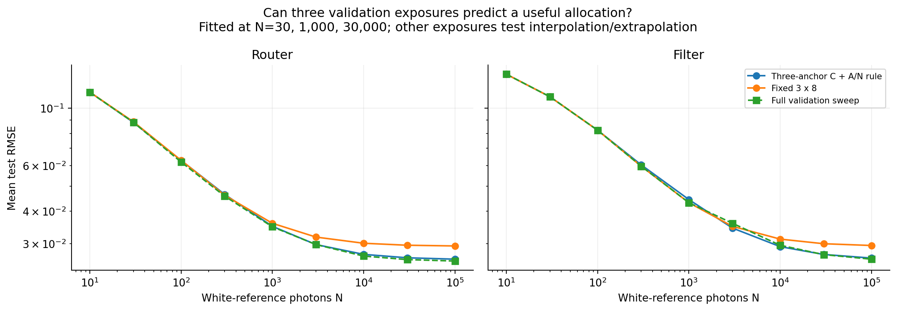

The model is motivated by a representation/quantization floor plus inverse-exposure shot-noise error for a fixed affine decoder. Clipping, low-bit thresholds and noise-dependent fitted decoders violate its simplest assumptions. Its success or failure must be judged from held-out error, not the appeal of the formula.

---

## 9. Does spectral complexity predict channel count?

Figure 10. Exploratory association between test-scene effective rank and its test-oracle high-light channel count. These are not inputs to the deployable selector.

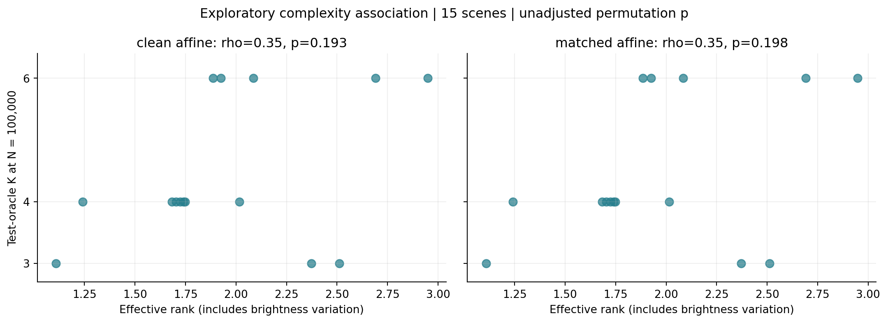

| Decoder | Raw-rank rho | Permutation p | Shape-rank rho |
| --- | --- | --- | --- |
| clean | 0.355 | 0.193 | -0.370 |
| matched | 0.355 | 0.198 | -0.370 |
| quadratic | 0.327 | 0.254 | -0.295 |
| interpolation | 0.565 | 0.032 | -0.450 |

The raw effective rank includes overall brightness variation. The shape-only statistic first normalizes spectra by their spectral sum. We report both because they answer different questions. Correlation with a test-oracle winner can be interesting but does not demonstrate a deployable intrinsic-dimension rule or causal dependence.

The original pilot correlation was based on fifteen scenes and one reconstruction protocol. These follow-up tests are exploratory, have tied channel counts, and are not corrected for the multiple related comparisons. A stable dimensionality-based design rule needs independent datasets and out-of-sample prediction of allocation, not merely an association measured after reconstruction.

In the revised matched-affine experiment, raw effective rank has rho=0.355 with unadjusted permutation p=0.198. The original stronger correlation therefore does not survive this change of split, pixel sample and reconstruction protocol. We do not claim that intrinsic rank predicts the optimal channel count.

---

## 10. What the reconstructions look like

Figure 11. A held-out balloons scene, spatially subsampled for display. All candidates use the same display gain and pseudo-color channels. This is a numerical reconstruction, not a hardware photograph.

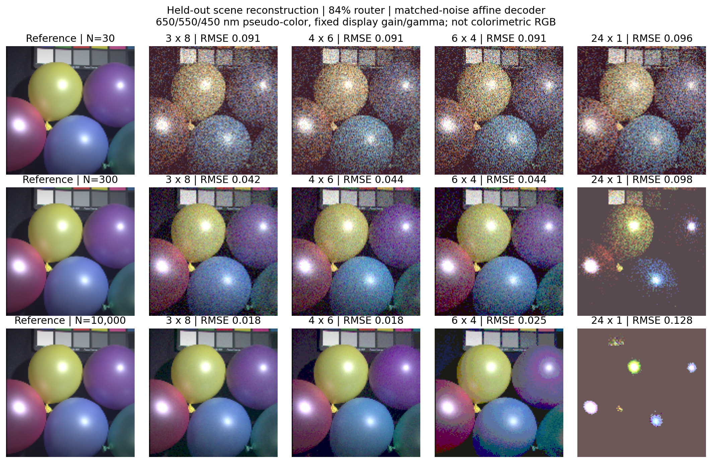

A one-bit ADC is not automatically an informative photon counter. With white-reference thresholds, dark channels can produce identical codes for many distinct spectra. The decoder then falls back toward a learned prior. More light can reduce the randomness that occasionally crosses a threshold without adding new code levels, so a coarse-ADC error curve need not improve monotonically.

The package also contains four fixed-grid pixel spectra and numerical arrays for these reconstructions. These examples explain appearance but are not substituted for the full scene-held-out quantitative evaluation.

---

## 11. Discussion, limitations and next validation

Answer to the question. There is no decoder-independent allocation established by this study. Under the specified constraints, allocation should be selected jointly with decoder calibration and evaluated on separate scenes. Photon-efficient routing changes the feasible error trade-off, while ADC settings and spectral priors can materially change the preferred K.

What remains outside this result. The data cover only fifteen supplied laboratory scenes. There is no second independent dataset, real optical transfer matrix, measured detector calibration or fabricated sensor. Spatial blur, demosaicing, unknown illumination, angular response, sensor area-dependent read noise and power are not optimized. Constant throughput and exposure-dependent ADC gain simplify real hardware.

Originality. Sampling-versus-bit-depth trade-offs are established [1-3], as are spectral mosaic optimization [4], photon routing [5] and optical channel-scaling analysis [6]. Application-specific spectral channel selection also has direct precedents [7]. The differentiating research question is the joint-budget routed/filter comparison with decoder-aware validation and quantified failure of overly simple design rules. A targeted search did not establish worldwide priority.

Next decisive test. Freeze the protocol and repeat on an independently acquired spectral dataset using measured or published wavelength-dependent responses. That tests transferability. A full hardware project additionally requires an achievable fixed-area optical design and measured photon statistics.

## References

[1] Laska & Baraniuk (2012). Regime Change: Bit-Depth versus Measurement-Rate in Compressive Sensing. IEEE TSP. doi:10.1109/TSP.2012.2194710. arxiv.org/abs/1110.3450.

[2] Ozcelikkale & Ozaktas (2012). Representation of optical fields using finite numbers of bits. Optics Letters 37, 2193-2195. doi:10.1364/OL.37.002193.

[3] Ozcelikkale & Ozaktas (2013). Beyond Nyquist sampling: a cost-based approach. JOSA A 30, 645-655.

[4] Yasuma et al. (2008). Generalized Assorted Pixel Camera: Post-Capture Control of Resolution, Dynamic Range and Spectrum. Columbia technical report CUCS-061-08.

[5] Zou et al. (2022). Pixel-level Bayer-type colour router based on metasurfaces. Nature Communications 13, 3288. doi:10.1038/s41467-022-31019-7.

[6] Han et al. (2026). Scaling Limits of Multichannel Spectral Routers for Snapshot Imaging. arXiv:2607.23508v2. Preprint.

[7] van Elst et al. (2025). Application-Specific Optimization of Integrated Spectral Sensors. ACS Photonics. doi:10.1021/acsphotonics.5c01213. Publisher excerpts/institutional record checked; full text not verified here.

Research assistance disclosure: ChatGPT assisted with modeling, implementation, simulation, analysis, literature checking and drafting. Vansh Jain supplied the project direction. The student must understand and verify the work before submission. This is an AI-assisted computational research draft, not a peer-reviewed publication.
